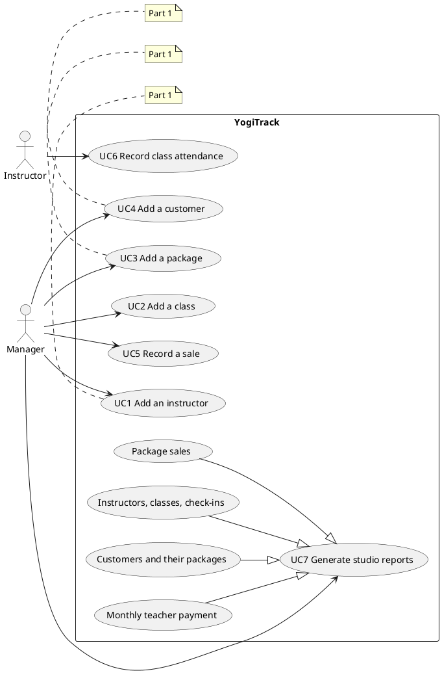
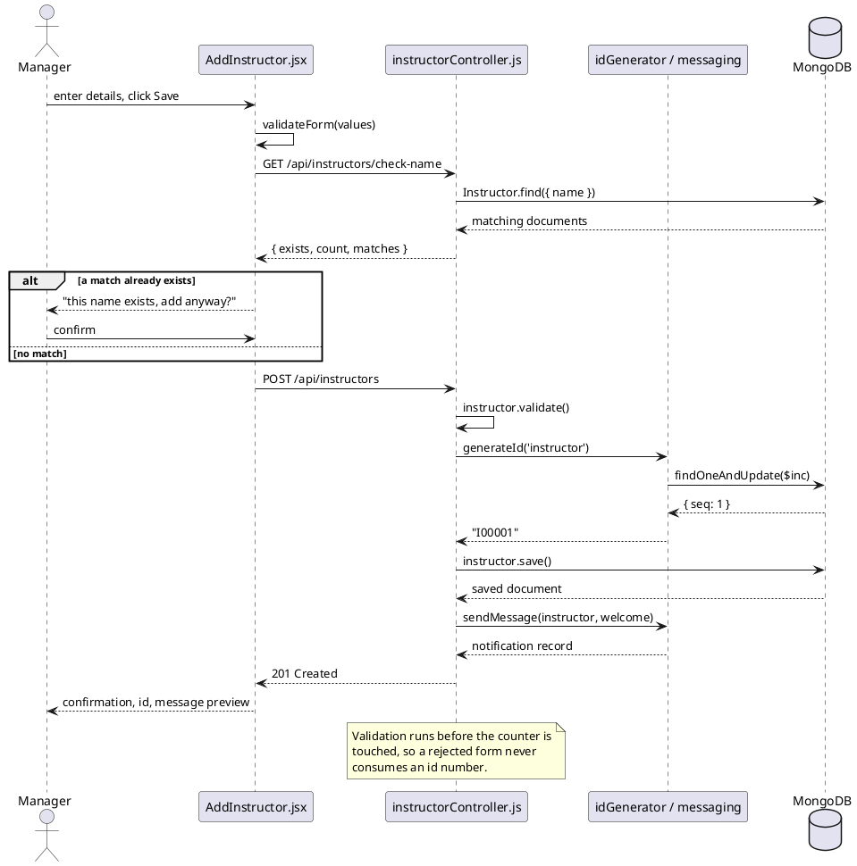
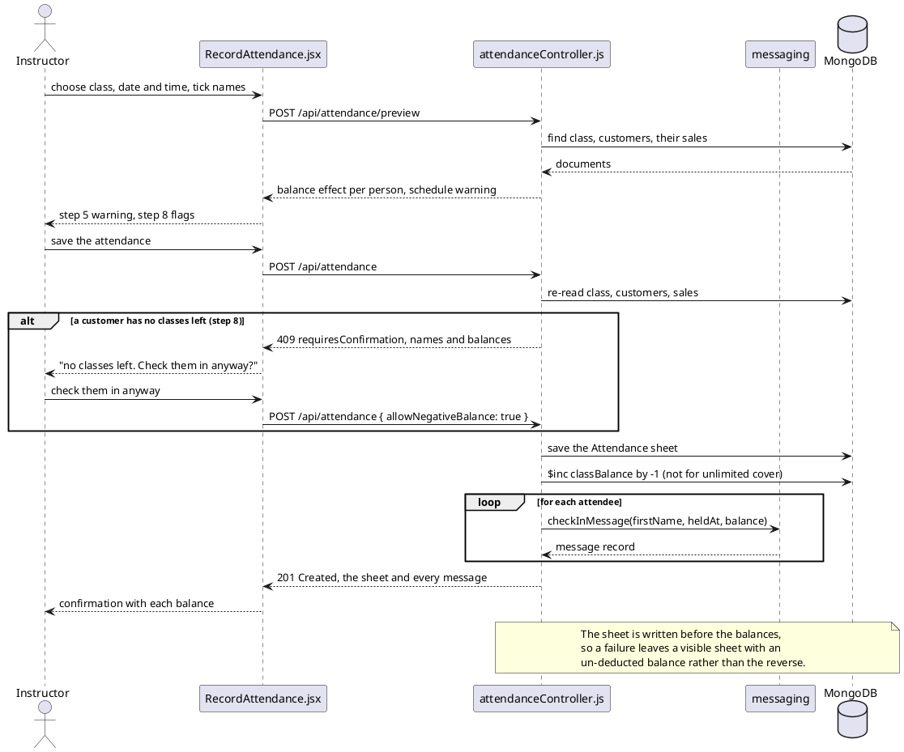
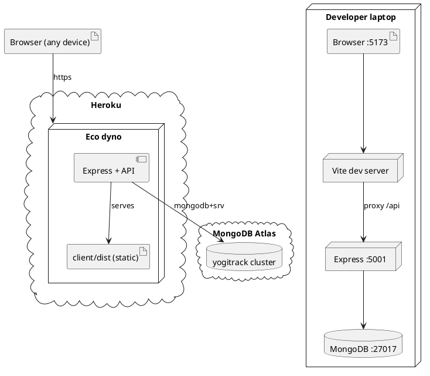

# UML models

Five models describe YogiTrack. Each is an SVG in `diagrams/`, drawn by hand so
the layout stays readable and the notes can carry the reasoning. PlantUML
source is included underneath each one so the diagrams can be regenerated or
edited later (render at plantuml.com or with the VSCode PlantUML extension).

All five were updated for Part 2: the class diagram gained `User`, the sale's
package snapshot and the embedded attendee record; the use-case diagram now
shows every use case as delivered; the architecture diagram names the
authentication middleware and the token service; and a second sequence
diagram covers UC6, which has the most branching of any flow in the system.

| Model | File | Answers |
|---|---|---|
| Use-case diagram | `diagrams/use-case-diagram.svg` | Who uses the system, and what can they do? |
| Class diagram | `diagrams/class-diagram.svg` | What data does it hold, and how is it related? |
| Sequence diagram, UC1 | `diagrams/sequence-uc1-add-instructor.svg` | What happens, in order, when a use case runs? |
| Sequence diagram, UC6 | `diagrams/sequence-uc6-record-attendance.svg` | How does the attendance flow handle its warnings and its override? |
| Architecture & deployment | `diagrams/architecture.svg` | What are the parts, and where do they run? |

---

## 1. Use-case diagram


Two actors. The **Manager** does everything to do with records and money; the
**Instructor** records attendance for their own classes. The four report
variants are drawn as specialisations of UC7 "Generate studio reports",
matching the structure of the course's own Fig. 5.

Green ellipses were delivered in Part 1; warm ones were added in Part 2. All
seven are now implemented.

Both actors sign in before any of this (design decision 12), and the role on
their account decides which of these use cases they can reach. Sign-in is not
drawn as a use case of its own because no course document specifies it as one;
it is a precondition of all seven.

This diagram covers the **written** specification in `04-use-cases.md`. The
course's Fig. 5 is broader: it shows Add/Modify/Delete, two view-only use
cases and a different set of report names. That gap is deliberate, catalogued
in `08-use-case-diagram.md` and settled as decisions 9, 10 and 11.

### PlantUML source



---

## 2. Class diagram


Eight collections and one embedded record: seven domain entities, the `users`
collection that authentication added in Part 2, and `counters`, which is
infrastructure rather than domain data but is shown because it is a real
collection that the ID generator depends on.

Three Part 2 additions are worth reading closely, because each is a decision
rather than a transcription of the specification:

- **`User`** (decision 12) points at an instructor by `instructorId` rather
  than duplicating their name and contact details, so the login and the staff
  record cannot drift apart.
- **`Sale` snapshots the package** it sold (decision 16): `packageName`,
  `classesPurchased`, `unlimited` and `classType` are copied at the moment of
  sale. A package is editable and a sale is history.
- **`Attendee` is an embedded record**, drawn with a filled diamond because
  it exists only inside its sheet (decision 17). It stores what the check-in
  DID to the balance, which is what makes UC6 step 8's negative balance
  resolvable later.

Three things worth pointing out to anyone reading this from a Java background:

- **A Mongoose schema is the class definition; a document is an instance.**
  The model object that `mongoose.model()` returns is what you call the static
  methods on (`Instructor.find()`), much like a Java class object.
- **`«FK»` is a convention, not a constraint.** MongoDB will happily store a
  `customerId` that matches no customer. There is no foreign-key enforcement
  and no `JOIN`. Wherever a reference matters, the Express controller has to
  check that the target exists — the database will not do it.
- **`/ fullName` is a derived attribute** (UML notation for a computed value).
  In Mongoose it is a *virtual*: a getter with no stored field behind it.

### PlantUML source

```plantuml
@startuml
hide circle
skinparam classAttributeIconSize 0

class Instructor {
  - instructorId : String {unique}
  - firstName : String
  - lastName : String
  - address : String
  - phone : String
  - email : String
  - preferredContact : ContactMode
  - active : Boolean
  + /fullName : String
}

class Customer {
  - customerId : String {unique}
  - firstName : String
  - lastName : String
  - address : String
  - phone : String
  - email : String
  - preferredContact : ContactMode
  - classBalance : Number
  + /fullName : String
}

class Package {
  - packageId : String {unique}
  - name : String
  - category : PackageCategory
  - numClasses : Number
  - unlimited : Boolean
  - classType : ClassType
  - startDate : Date
  - endDate : Date
  - price : Number
}

class Class {
  - classId : String {unique}
  - instructorId : String
  - day : Day
  - time : String "HH:MM"
  - durationMinutes : Number = 60
  - classType : ClassType
  - payRate : Number
  + /endTime : String
}

class Sale {
  - saleId : String {unique}
  - customerId : String
  - packageId : String
  - packageName : String
  - classesPurchased : Number
  - unlimited : Boolean
  - classType : ClassType
  - amountPaid : Number
  - paymentMode : PaymentMode
  - paidAt : Date
  - validFrom : Date
  - validTo : Date
  + /status : SaleStatus
}

class Attendance {
  - attendanceId : String {unique}
  - classId : String
  - instructorId : String
  - heldAt : Date
  + /headcount : Number
}

class Attendee <<embedded>> {
  - customerId : String
  - usedUnlimited : Boolean
  - balanceBefore : Number
  - balanceAfter : Number
}

class User {
  - username : String {unique}
  - passwordHash : String
  - role : Role
  - instructorId : String
  - active : Boolean
  - lastLoginAt : Date
  + verifyPassword(plain) : Boolean
}

class Counter {
  - _id : String
  - seq : Number
}

enum ContactMode { phone
email }
enum ClassType { General
Special }
enum PackageCategory { General
Senior }
enum PaymentMode { Cash
Card
Check }
enum Role { manager
instructor }

User       "0..1" --> "1" Instructor : signs in as
Instructor "1" --> "0..*" Class : teaches
Customer   "1" --> "0..*" Sale : buys
Package    "1" --> "0..*" Sale : sold as
Class      "1" --> "0..*" Attendance : held as
Instructor "1" --> "0..*" Attendance : records
Attendance "1" *-- "1..*" Attendee : attendees
Customer   "1" --> "0..*" Attendee : attends

note right of Counter
  Supplies every I/C/P/L/S/A id
  by atomic $inc. Infrastructure,
  not a domain entity.
end note

note bottom of Sale
  packageName, classesPurchased,
  unlimited and classType are copied
  from the Package at the time of sale.
  Decision 16.
end note
@enduml
```

---

## 3a. Sequence diagram — UC1, Add an instructor


UC1 was chosen for the sequence diagram because it is the only Part 1 use case
with a branch in it: the duplicate-name confirmation. The numbered green labels
tie each message back to a step in the written use case, so the diagram can be
read side by side with `04-use-cases.md`.

Two details the diagram is specifically there to make visible:

- **The `alt` fragment** is the two-step duplicate interaction (design decision
  2). The form asks the server whether the name exists *before* it tries to
  save. Only a match produces a prompt. Two instructors genuinely may share a
  name, so this is a question, not a rejection.
- **Validation (message 10) happens before ID generation (message 11).** This
  ordering is not cosmetic; see the note on the diagram and design decision 15.

### PlantUML source



---

## 3b. Sequence diagram — UC6, Record class attendance


UC6 was chosen as the second sequence diagram because it is the most
branching flow in the system and the only one that writes to three places at
once: the sheet, every attendee's balance, and a message to each of them.

What the diagram is there to make visible:

- **The preview and the save run the same assessment.** The warning the
  instructor sees while ticking names comes from the same function that
  decides what is written on save, so the two cannot disagree. The save
  repeats the work rather than trusting what the browser already asked,
  because the browser is not where a rule can live.
- **The `alt` fragment is UC6 step 8**, and like UC1's duplicate-name prompt
  it is a question rather than a rejection. The specification explicitly
  requires the option to continue and record a negative balance to be settled
  later, so the second request carries `allowNegativeBalance: true`.
- **The `loop` fragment is step 10.** Each attendee is messaged with the
  balance that was actually written, including a negative one.
- **The sheet is saved before the balances change.** If the balance update
  failed, the studio would have a visible sheet and an un-deducted balance,
  which a manager can see and fix. The other order would deduct classes with
  no record of the class, which nobody would ever notice.

### PlantUML source



---

## 4. Architecture and deployment


Three views in one figure:

1. **Component view** — the path a single request takes through the folders of
   the repository. Every use case follows this same path, which is the point of
   organising the server into `routes / controllers / services / models`
   instead of putting the logic in one file.
2. **Deployment view** — development versus production. The interesting part is
   what *changes*: in development two processes run on two ports and Vite
   proxies `/api` to Express; in production one Heroku process serves both the
   compiled React build and the API. Because the frontend only ever uses
   relative URLs, no application code differs between the two.
3. **Delivery pipeline** — commit, push, build and test, then release.

### PlantUML source (deployment view)


