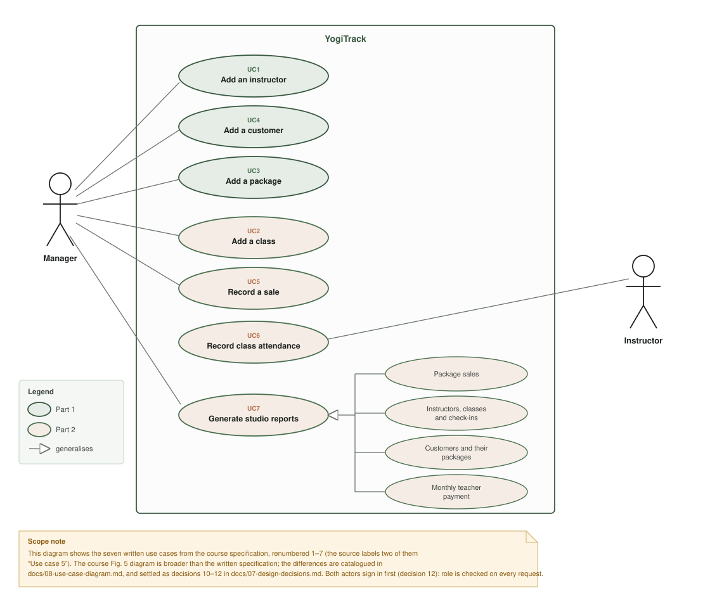
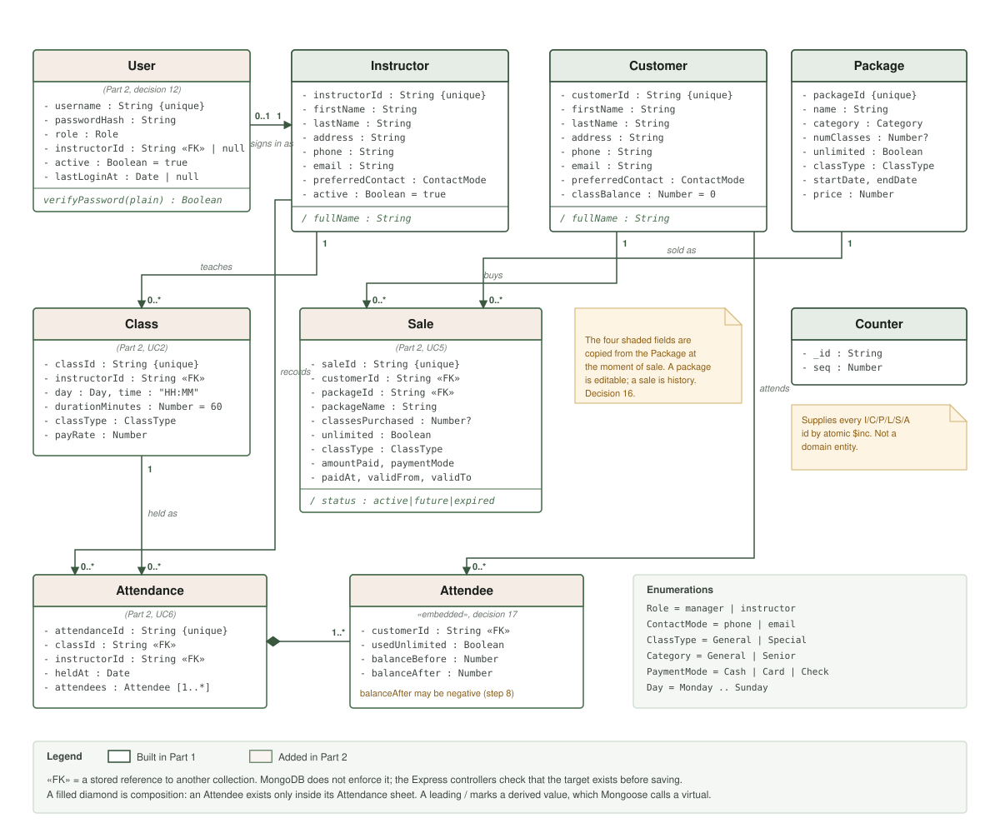
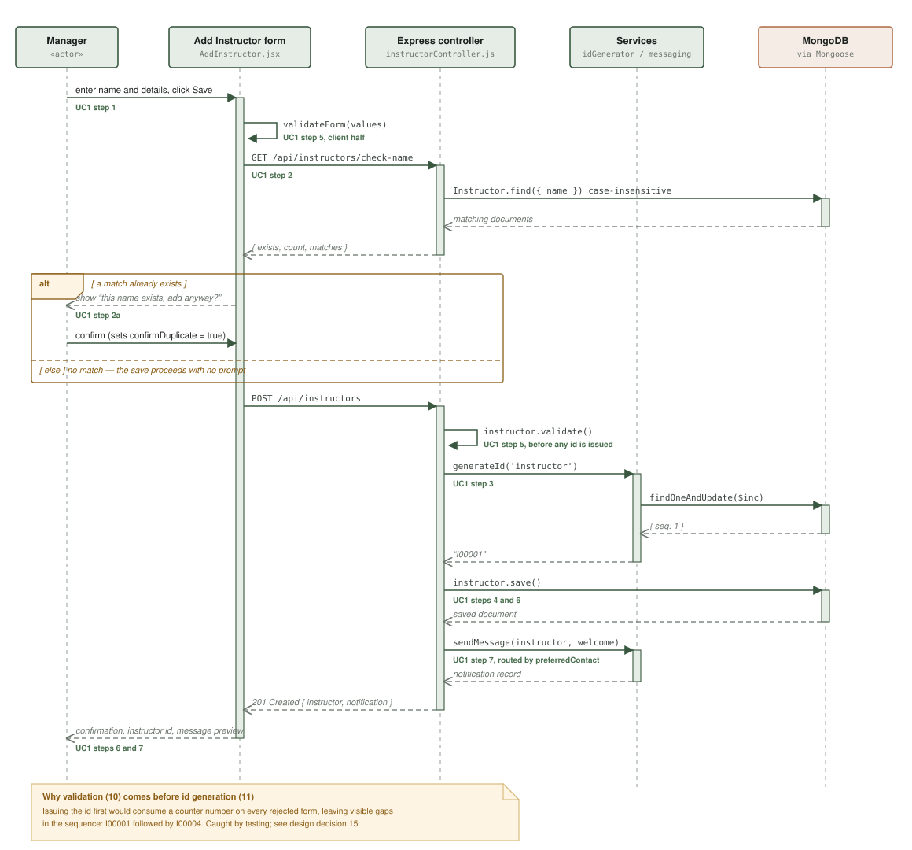
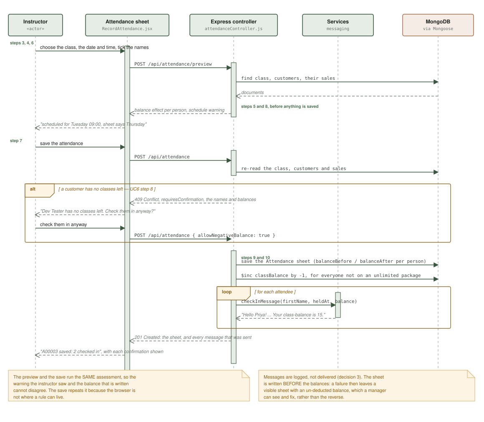
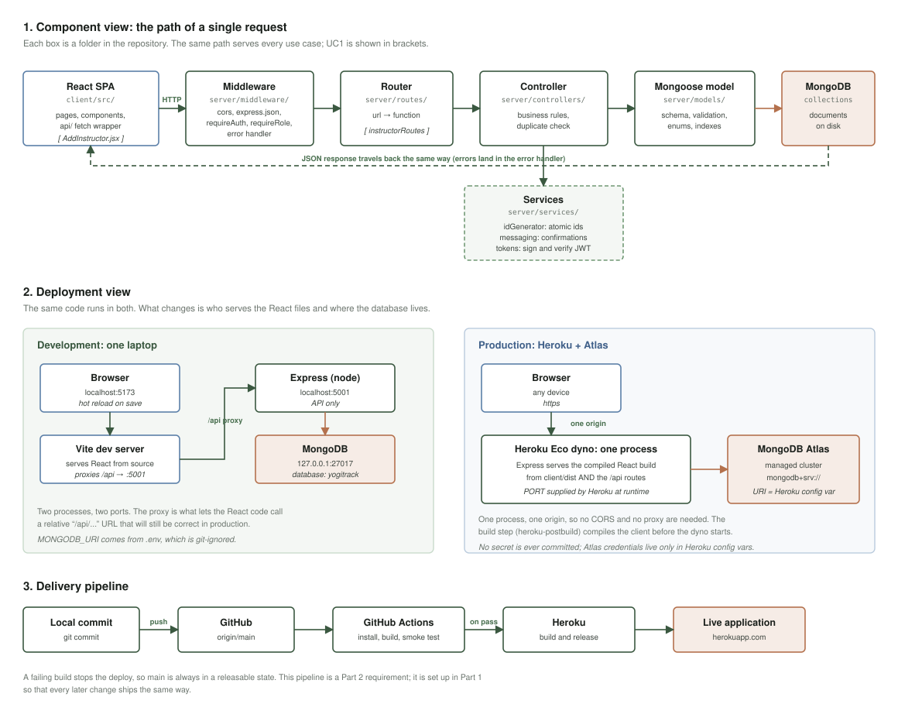

# YogiTrack: Project Report, Part 2

**Course:** ACS 5423, Software Development for World Wide Web
**Institution:** University of Oklahoma
**Application:** YogiTrack, a record-keeping system for the Yoga H'om studio
**Increment:** Application 2.0 (Part 2), the final submission
**Technology stack:** MongoDB · Express · React · Node.js (MERN)
**Live application:** https://yogitrack-zb-9cc3ff17df1c.herokuapp.com
**Repository:** https://github.com/ZB56/yogitrack

This report supersedes the Part 1 report. It describes the whole application,
with the Part 2 work marked throughout, so it can be read on its own.

---

## Contents

1. [Executive summary](#1-executive-summary)
2. [Problem statement and background](#2-problem-statement-and-background)
3. [Scope](#3-scope)
4. [Use cases](#4-use-cases)
5. [UML models](#5-uml-models)
6. [Key design decisions](#6-key-design-decisions)
7. [Technology stack and how it is used](#7-technology-stack-and-how-it-is-used)
8. [Code organisation](#8-code-organisation)
9. [User interface design](#9-user-interface-design)
10. [Testing and verification](#10-testing-and-verification)
11. [Deployment and the delivery pipeline](#11-deployment-and-the-delivery-pipeline)
12. [Known limitations and what would come next](#12-known-limitations-and-what-would-come-next)
13. [Appendix A: API reference](#appendix-a-api-reference)
14. [Appendix B: running the project](#appendix-b-running-the-project)

---

## 1. Executive summary

Yoga H'om runs its studio on paper: a card per customer for classes bought and
attended, and a signed sheet per class. That process does not scale and cannot
answer questions like "how much do we owe each instructor this month?" without
manual tallying.

YogiTrack replaces those records with a web application. **All seven use cases
from the course specification are implemented**, and the application is
deployed, with a GitHub repository and a CI pipeline that gates every release.

| # | Use case | Delivered | Actor |
|---|---|---|---|
| UC1 | Add an instructor | Part 1 | Manager |
| UC4 | Add a customer | Part 1 | Manager |
| UC3 | Add a package | Part 1 | Manager |
| UC2 | Add a class | **Part 2** | Manager |
| UC5 | Record a sale | **Part 2** | Manager |
| UC6 | Record class attendance | **Part 2** | Instructor |
| UC7 | Generate studio reports | **Part 2** | Manager |

**Part 2 also added authentication**, which the Part 1 review asked for:
accounts with bcrypt-hashed passwords, a signed token, and a role of manager
or instructor checked on the server for every protected request. That is what
finally makes the specification's two actors real; before it, "the Instructor"
was a label on a diagram rather than something the application could tell
apart.

### What Part 2 contributes, beyond four more forms

- **A rule the system enforces about time.** UC2 cannot simply save what it is
  given: only one class may run at a time, so a clash has to be detected and
  somewhere else has to be proposed. That meant settling what a class length
  even is, which the specification never states.
- **Money that has to add up.** UC5 validates the amount against the price
  list, the payment date against today, and the validity window against the
  package's own rules, then moves a balance. It is the first place where two
  collections change together, so the order of those writes matters.
- **The first use case with a deliberate exception.** UC6 must let an
  instructor check in a customer who has run out of classes, recording a
  negative balance to be settled later. The system's job there is to make the
  consequence visible, not to prevent it.
- **Questions answered inside the database.** UC7's four reports are MongoDB
  aggregation pipelines, so joining, grouping and totalling happen next to the
  data rather than after it has been copied out.
- **A security boundary.** Authentication is enforced in Express middleware,
  not in React. The interface hides what a role cannot use as a courtesy; the
  server is what makes it impossible.

### What the whole application now does

Nine collections' worth of studio record-keeping: who teaches, who attends,
what the studio sells, what is on the timetable, what has been sold, who was
in the room, and what all of that adds up to at the end of the month.

---

## 2. Problem statement and background

Yoga H'om was founded in 2003 in the suburbs of Pittsburgh, offering affordable
yoga education to its community. It runs classes every day, taught by a number
of instructors, with a published schedule. Some classes are general; others are
specialised, such as Chair Yoga for seniors or Gentle Yoga for beginners.

Customers buy class passes: a 4-class or 10-class package, a 3-month unlimited
package, or a single drop-in pass. All packages have a validity period, and
seniors get a discounted rate. The studio also runs workshops and special
programme series at separate prices.

**The current process is manual.** A paper card per customer is ticked off as
classes are bought and attended. A paper attendance sheet is signed at each
class, recording the attendee, the package used, and the payment mode.

**The problem.** These manual processes have become a bottleneck to growth and
operational efficiency. Records are duplicated across cards and sheets, they
can only be read in one physical place, and any question spanning more than one
customer requires a manual count. The studio has therefore begun automating,
starting with record-keeping for instructors, customers, packages, the class
schedule, and attendance.

**The goal of this application** is to make those records authoritative,
queryable and remotely accessible, so that the studio's day-to-day work no
longer depends on paper.

---

## 3. Scope

### 3.1 How the work was split, and why that order

The seven use cases form a dependency tree:

```
    Instructor ──> Class ──────────┐
    Package ───┐                   ├──> Attendance ──> Reports
    Customer ──┴──> Sale ──────────┘
```

A class cannot be scheduled without an instructor. A sale cannot be recorded
without both a customer and a package. Attendance needs all of them, and the
reports aggregate everything.

Part 1 built the three roots of the tree, which made **Part 2 purely
additive**: not one Part 1 schema had to be redesigned to make Part 2 work.
The only change to a Part 1 model in the whole of Part 2 was adding a class
type to the sale snapshot, and that was a Part 2 field on a Part 2 model.

Within Part 2 the same ordering logic applied, with one exception.
Authentication was built **first**, before any of the four use cases, even
though it is not a use case at all. Two of the four needed it in order to be
built correctly rather than retrofitted: UC2 sends a confirmation "to the
manager", and UC6 shows "the classes assigned to the instructor". Both
questions have no answer until the application knows who is signed in.
Building the use cases first would have meant inventing a stand-in for the
current user and then replacing it.

### 3.2 What is deliberately out of scope

Every exclusion below is a recorded decision with a reason, not an omission.

| Excluded | Reason |
|---|---|
| Modify and delete | No written use case asks for them, and by Part 2 the referential-integrity problem is real rather than hypothetical: classes reference instructors, sales reference customers and packages, attendance references all of them, and a customer's balance is derived from that history. The `active` flag exists on every schema so deactivation is a small change when a specification asks for it. Decision 9. |
| The diagram-only use cases | Publish Class Schedule, View Class Schedule and View Class Attendance appear in the course's Fig. 5 and in no written specification, so there is nothing to build against: scope, actors and acceptance would all have been invented. What the written use cases produced covers the intent: saving a class publishes it (UC2 step 5), the schedule is readable at `/classes`, and attendance at `/attendance`. Decision 10. |
| The diagram's five report names | The written UC7 names four reports and defines them. The diagram names five different ones and defines none. Section 4.7 maps one list onto the other. Decision 11. |
| Real message delivery | Confirmations are generated, displayed and logged, but not transmitted. Sending them needs a paid provider account and its API keys, which is a studio purchasing decision rather than a development one. Every call site already goes through one `sendMessage` function, so the swap is one function body. Decision 3. |
| Per-package class balances | The specification defines one `classBalance` per customer. That is what is built, with the consequence described in section 4.6 and decision 18. |

### 3.3 Responding to the Part 1 review

The Part 1 submission scored 25/25, with one instruction for the final
submission: **"have authentication implemented."**

Section 4.8 describes what was built in response: real accounts rather than a
role selector, hashed passwords, a short-lived signed token, and role checks
in Express middleware on every protected route. The review also noted that the
application felt quick; section 7.1 describes the indexes added in Part 2 to
keep it that way as the collections grow.

---

## 4. Use cases

The course specification labels two different use cases "Use case 5" and labels
reports "Use case 6". They are renumbered 1–7 throughout this report; the
original labels are given in parentheses. This is recorded as decision 6.

### 4.1 UC1: Add an instructor *(original: Use case 1)*

**Actor:** Manager
**Goal:** Put a new instructor on file and tell them their ID.

**Data captured:** first name, last name, address, phone, email, preferred mode
of communication (phone or email).

**Flow as implemented:**

| Step | Specification | Implementation |
|---|---|---|
| 1 | Manager enters first and last name | React form, `AddInstructor.jsx` |
| 2 | System checks whether the name already exists | `GET /api/instructors/check-name`, a case-insensitive exact match |
| 2a | If it exists, prompt to confirm | Warning panel with "Yes, add anyway" / "Cancel and edit"; the server independently returns `409` with `requiresConfirmation` |
| 3 | System generates a new instructor ID | `generateId('instructor')` → `I00001` |
| 4 | Manager enters remaining data and saves | Same form, one submit |
| 5 | System validates and prompts on missing fields | Validated in the browser *and* by the Mongoose schema; errors are returned per field and shown beside the offending input |
| 6 | System confirms the record is saved | Success panel showing the generated ID |
| 7 | System sends a welcome message on the preferred channel | `sendMessage()` routes by `preferredContact`; the exact message is displayed |

> **A note on step numbering.** The course specification gives this flow as
> seven steps, with the duplicate-name prompt as a sub-flow of step 2 rather
> than a step of its own. Every step reference in this report and in the code
> comments uses that numbering, so any of them can be checked directly against
> the source document.

**Note on IDs.** An instructor ID begins with **I** and a customer ID with
**C**, so the two can never be confused. This is a requirement of the
specification, not a convention we invented.

**Beyond the specification:** a read-only instructor list, so that saved
records are actually visible. See decision 9.

### 4.2 UC4: Add a customer *(original: Use case 4)*, implemented

Identical in shape to UC1 in every respect: the same six demographic fields,
the same duplicate-name check, the same generated ID (prefixed **C**) and the
same welcome message. It adds one field: **class balance**, which starts at 0 and is later changed by
UC5 (a sale increases it) and UC6 (attendance decreases it).

Because the two use cases are so nearly the same, the second was built by
**extracting what they share rather than copying it**:

| Shared thing | Where it lives | Used by |
|---|---|---|
| The six demographic fields and their validation | `server/models/personFields.js` | Both schemas |
| The case-insensitive, anchored name match | `server/utils/nameLookup.js` | Both duplicate checks |
| The whole add-a-person form | `client/src/components/PersonForm.jsx` | Both pages |
| ID generation and messaging | `server/services/` | Both controllers |

`AddInstructor.jsx` and `AddCustomer.jsx` are now thin wrappers that supply
only what genuinely differs: the wording, which API functions to call, and
where the "view all" link points. Copied code drifts: a fix applied to one
copy silently fails to reach the other. Extracting it makes that drift
impossible by construction. This is the reason UC1 was built first and
completely: it established a pattern that UC4 follows rather than reinvents.

**One rule specific to UC4:** `classBalance` is never read from the request
body. UC4 fixes the opening balance at 0, and only a recorded sale (UC5) or
attendance (UC6) may change it. Accepting it from the form would let a manager
type in a balance that no sale ever paid for. This was verified by submitting
a request containing `classBalance: 999` and confirming the stored value was
still 0.

**Also note what is *not* constrained:** the schema deliberately sets no
minimum on `classBalance`. UC6 step 8 requires that an instructor be able to
check in a customer who has run out of classes, saving a negative balance to
be resolved later. A `min: 0` would make that legitimate case impossible, so
the customer list highlights a negative balance instead of preventing it.

### 4.3 UC3: Add a package *(original: Use case 3)*

**Actor:** Manager
**Data captured:** package name; category (General or Senior); number of
classes (1, 4, 10, or unlimited); class type (General or Special); start date;
end date; price.

**Flow:** the manager enters the data and the system generates a package ID
and confirms. Two steps, no branch, which is why it was scheduled last of the
three: it exercises no pattern the other two had not already established.

**The studio's actual price list** (Fig. 2 of the requirements) is what the
schema had to accommodate, and it is loaded by `npm run seed:packages`:

| Package | Category | Classes | Validity | Price |
|---|---|---|---|---|
| Single Class (Drop in) | General | 1 | 1 month | $20 |
| 4 Class Pass | General | 4 | 1 month | $70 |
| 10 Class Pass | General | 10 | 3 months | $140 |
| 3 Months Unlimited | General | Unlimited | 3 months | $400 |
| 4 Class Pass | Senior | 4 | 1 month | $60 |
| 10 Class Pass | Senior | 10 | 3 months | $120 |
| 3 Months Unlimited | Senior | Unlimited | 3 months | $360 |

Seeding is a development convenience, not part of the use case: the manager
can add any package through the form. It exists so that demonstrating and
testing the application does not require typing seven rows by hand, and it is
idempotent, so running it twice is harmless.

Note that "Senior" is a **pricing category the manager chooses**, not something
the system derives. The price list defines a senior as 62 or older, but no use
case asks for a date of birth, so no age is stored anywhere.

**The interesting problem here is "unlimited."** A 3-month unlimited package
has no number of classes, and a plain number cannot represent that honestly.
The chosen representation is a boolean flag with date-based validity rather
than a sentinel number; the reasoning, and the rejected alternative, are in
decision 4.

This shows up in the schema in a way worth pointing out. `numClasses` declares
its `required` rule as a **function** rather than `true`:

```js
numClasses: {
  type: Number,
  default: null,
  required: [function () { return !this.unlimited; },
             'Please choose how many classes this package includes.'],
  ...
}
```

Mongoose calls that function with the document as `this`, so the field is
mandatory for a counted package and legitimately absent for an unlimited one.
A plain `required: true` would have made the 3-month unlimited pass, one of
the studio's seven real products, impossible to save.

Two further rules are enforced at the schema rather than trusted from the
form: the class count must be one the studio actually sells (1, 4 or 10), and
the end date must fall after the start date, because a package that expires
before it begins can never be sold. The controller additionally forces
`numClasses` to `null` whenever `unlimited` is true, so a contradictory
request body cannot be stored in a state that later code could read two ways.

### 4.4 UC2: Add a class *(original: Use case 2)* — Part 2

**Actor:** Manager
**Data captured:** instructor, day, time, class length, class type (General or
Special), pay rate.

A class in YogiTrack is a **weekly slot in the timetable**, not a single dated
occurrence. That follows the requirements: Fig. 1 is a weekly schedule and UC2
collects a day and a time rather than a date. A particular Tuesday only
becomes a record when attendance is taken for it, which is also how the
studio's paper sheets work.

**Flow as implemented:**

| Step | Specification | Implementation |
|---|---|---|
| 1 | Manager chooses to create a class and enters the data | `AddClass.jsx` |
| 2 | System checks for a schedule conflict, as only one class can be held at a time | `GET /api/classes/check-conflict` runs as the form is filled in; `POST /api/classes` checks again before saving |
| 3 | If there is a conflict, the system suggests other options | Up to four free slots, offered as buttons |
| 4 | Manager selects one of the options | Clicking a suggestion moves the form to that slot |
| 5 | Manager confirms and publishes the schedule | Saving puts it in the schedule; there is no separate publish state |
| 6 | System confirms to the manager and to the instructor | `sendMessage` to the instructor on their preferred channel, `sendStudioMessage` for the manager's copy |

**The problem the specification leaves open: how long is a class?** "Only one
class can be held at any time" cannot be tested without a length, and the
course documents never give one. The answer adopted is a `durationMinutes`
field defaulting to 60 (decision 5). A field rather than a constant, because
the studio runs workshops that are plainly not an hour, and because the class
diagram carried `durationMinutes` from Part 1.

With a length, a conflict is the standard interval-overlap test, expressed as
a method on the model so that the rule lives with the data it describes:

```js
classSchema.methods.clashesWith = function (slot) {
  if (this.day !== slot.day) return false;

  const thisStart  = timeToMinutes(this.time);
  const thisEnd    = thisStart + this.durationMinutes;
  const otherStart = timeToMinutes(slot.time);
  const otherEnd   = otherStart + slot.durationMinutes;

  return thisStart < otherEnd && otherStart < thisEnd;
};
```

Times are stored as 24-hour `"HH:MM"` text and converted to minutes for the
comparison. Text, because a weekly slot has no date attached and a `Date`
would drag a timezone into a value that has none; minutes, because it turns
the overlap rule into two ordinary inequalities. The comparison is strict on
both sides, so touching slots do not clash and a 60-minute class at 09:00
leaves 10:00 free.

**Step 3 is where this use case earns its keep.** Refusing a clash is easy;
proposing somewhere to put the class instead is what makes the rule usable.
The alternatives are offered nearest-first in the order a manager actually
thinks about them: later the same day in half-hour steps, then earlier the
same day, then the same time on following days. A manager with a clash
usually wants to nudge the class an hour, not move it to Sunday.

Suggestions stay inside a 06:00–21:00 studio day, which is an assumption: the
requirements say the studio runs classes every day but never give opening
hours. It limits only what YogiTrack *proposes*; a manager may still enter any
valid time, which is why the schema accepts any 24-hour time.

**A clash cannot be overridden, and that is the difference from UC1.** The
duplicate-name prompt in UC1 can be confirmed through, because two people
genuinely may share a name. Two classes cannot share one room at one time, so
`POST /api/classes` answers `409` with the alternatives and no way to force
it. The HTTP status is the same; what the body offers is not.

**Beyond the specification:** a schedule list at `/classes`, for the same
reason Part 1 added list views. The server narrows it to the signed-in
instructor's own classes, which is exactly what UC6 step 2 needs.

### 4.5 UC5: Record a sale *(original: Use case 5)* — Part 2

**Actor:** Manager
**Data captured:** customer, package, amount paid, mode of payment, date and
time of payment, validity start and end.

**Flow as implemented:**

| Step | Specification | Implementation |
|---|---|---|
| 1 | Manager chooses to record a sale | `RecordSale.jsx` |
| 2 | System prompts for the data and auto-populates the package type | `GET /api/sales/quote` returns the price, the validity window and the customer's current balance; the form fills itself in |
| 3 | Manager enters the data | Auto-filled fields stay editable, because the use case lists them as entered data |
| 4 | System validates the data | Three rules, below |
| 5 | System updates the class balance | `$inc` on the customer document |
| 6 | System displays the new balance and confirms | Success panel naming the package, the amount, the classes added and the new balance |

**The three validations in step 4**, each quoted from the specification:

- *"Amount paid is as per the package rate."* The amount is compared against
  the package's price. Prices are stored as floating-point dollars, so the
  comparison uses a half-cent tolerance rather than `===`; the note in
  `Package.js` explains why a production billing system would store cents as
  integers instead.
- *"Date and time are current."* Read as: the sale is being recorded as it
  happens, so the timestamp must be today. A future time is a typo, and an
  older one would be a back-dated sale, which the use case does not describe.
  A minute of slack is allowed because the browser's clock and the server's
  rarely agree to the second.
- *"Start and end dates are as per the package rules and are current."* The
  package's own validity window gives the LENGTH ("4 Class Pass, validity one
  month" is stored as two dates a month apart), so buying it today gives a
  window of the same length starting today. The server re-derives that window
  and rejects anything that does not match, rather than quietly correcting it.

Errors from all three are collected and returned together, so a manager sees
everything that is wrong in one pass instead of fixing three things in a row.

**A sale snapshots the package it sold.** `packageName`, `classesPurchased`,
`unlimited` and `classType` are copied onto the sale at the moment it is
recorded, as well as the `packageId` reference. The duplication is deliberate
(decision 16): a package is editable and a sale is a historical fact. If a
sale held only a reference, raising the price of the 10 Class Pass would
silently rewrite every sale ever made of it, and the package sales report
would show revenue the studio never took.

**Step 5, and the order of two writes.** The sale is written first, then the
balance is incremented:

```js
const updatedCustomer = await Customer.findOneAndUpdate(
  { customerId: customer.customerId },
  { $inc: { classBalance: classesAdded } },
  { new: true }
);
```

Two details. `$inc` rather than reading the balance and writing it back,
because the increment is a single atomic operation inside MongoDB and two
sales recorded at the same moment cannot lose one of them. And the sale before
the balance, because if the second write failed the studio would have a
recorded payment and an un-credited balance, which a manager can see and fix;
the other order would credit classes with no record of payment, which nobody
would ever notice.

**An unlimited package adds nothing to the counter.** Entitlement for it is
decided by the validity dates, not by counting down (decision 4), so
`classesAdded` is 0 and the success panel says so in words rather than
reporting a balance that did not move.

### 4.6 UC6: Record class attendance *(original: the second "Use case 5")* — Part 2

**Actor:** Instructor
**Purpose:** mark who attended a class, which updates their class balances.

This is the use case the rest of the data model exists to support, and the
only one that writes to three places at once: the sheet, every attendee's
balance, and a message to each of them.

**Flow as implemented:**

| Step | Specification | Implementation |
|---|---|---|
| 1 | Instructor chooses to enter attendance | `RecordAttendance.jsx` |
| 2 | System lists the classes led by that instructor | `GET /api/classes`, narrowed from the signed-in user's token |
| 3 | Instructor chooses the class | Dropdown |
| 4 | Sheet opens with the current date and time, editable | `datetime-local`, defaulted to now |
| 5 | Warning if the date and time do not match the schedule | Computed on the server and shown as a warning panel |
| 6 | Instructor picks customers from the list | Searchable tick-list, with each person's balance alongside |
| 7 | Instructor saves | `POST /api/attendance` |
| 8 | System flags anyone short of balance and offers to continue | `409` with `requiresConfirmation` and the names; resending with `allowNegativeBalance` goes ahead |
| 9 | If valid, the sheet is saved | `A00001` |
| 10 | Balances are updated and each attendee is messaged | `$inc` per attendee, then the specification's exact check-in wording |

**Step 5 is a warning, not an error,** because a class genuinely can be moved
or made up on another day, and the sheet should record when it was actually
held. The system's job is to make the discrepancy visible:

> L00001 is scheduled for Tuesday at 09:00, but this sheet says Thursday at
> 09:00.

**Step 8 is the most interesting rule in the specification.** It requires that
an instructor be able to check in a customer with no classes left, "to be
resolved later". So an insufficient balance is a question, not a refusal, and
it uses the same convention as UC1's duplicate name: `409` with
`requiresConfirmation`, the names and what each balance would become, and a
second request that goes ahead. Nothing in the schema prevents a negative
balance either; `classBalance` has deliberately no minimum, and the customer
list colours it instead.

**What a check-in costs is decided in one place**, so the preview the
instructor sees while ticking names and the figure that is written on save
cannot disagree:

1. An active unlimited package covers the class and deducts nothing.
2. Otherwise one class comes off the balance.
3. A balance that cannot cover it is flagged for step 8.

"Active" is judged at the time of the **class**, not the time of typing, so a
sheet filed on Monday for Friday's class is judged by whether the package
covered the customer on Friday.

**The sheet records what the check-in did, not just who was there.** Each
attendee is stored as a sub-document with `usedUnlimited`, `balanceBefore` and
`balanceAfter`. This is the one place the built model deliberately differs
from the Part 1 data-model sketch, which had a plain array of customer IDs
(decision 17). Step 8's negative balance is only resolvable later if the sheet
says what happened, and without `usedUnlimited` a reader cannot tell a
legitimate free check-in from a balance that failed to decrement.

**One rule is reported rather than enforced, and the report says so.** The
requirements state that a Special package admits its holder only to Special
classes. The data model the use cases specify keeps one balance per customer,
not a balance per package type, so once a counted check-in is made the system
cannot tell which purchase it drew on. Blocking on class type would mean
enforcing a rule the data cannot support, and would wrongly refuse a customer
holding both a General and a Special package. So the sheet flags "No active
Special package on file" and leaves the judgement with the instructor
(decision 18). The honest fix is per-package balances, which is a change to
the specified data model; it is listed in section 12.

**Step 10's message** reproduces the specification's wording and its `dd/mm/yy`
format exactly, including a negative balance where there is one:

> Hello Priya! You are checked-in for a class on 15/10/26 at 9:00 am. Your
> class-balance is 15.

### 4.7 UC7: Generate studio reports *(original: Use case 6)* — Part 2

**Actor:** Manager
**Four reports**, as the written use case names them:

| Report | What it answers | Pipeline |
|---|---|---|
| Package sales | What sold, how many, and what it brought in | `$group` by the sale's snapshot of the package, then totals |
| Instructors | Each instructor's classes, classes held and check-ins | `$lookup` to classes and attendance, `$map` to keep four fields per class, `$sum` of each sheet's attendee count |
| Customers | Each customer's packages, labelled active, future or expired | `$lookup` to sales, `$switch` against `$$NOW` |
| Teacher payment | What each instructor is owed for a month | `$match` on the month, `$lookup` for the pay rate, `$group` per instructor |

**Why aggregation pipelines.** Each report could have been a `find()` followed
by JavaScript. A pipeline is a list of stages that runs **inside the
database**, so the joining, grouping and arithmetic happen next to the data
instead of after every document has been copied across the network. It is also
the part of MongoDB that most repays understanding, and the course asks for a
design that demonstrates the stack rather than merely uses it.

Two details worth drawing out:

- **The customer report computes its labels at read time.** `$switch` compares
  each sale's validity window against `$$NOW`, the server's clock, so a
  package that lapsed overnight reads as expired without anything being
  rewritten. Storing a status on the sale would mean every document in the
  collection going stale while nobody is looking.
- **The payment report filters before it joins.** `$match` on the indexed
  `heldAt` comes first, so the `$lookup` runs against one month of sheets
  rather than the whole collection. Stage order is a performance decision, not
  a stylistic one.

**One assumption, stated.** UC7 says the payment report is "based on the
pay-rate and class check-ins". The pay rate is treated as what an instructor
earns each time the class is **held**, and a class counts as held when an
attendance sheet exists for it. Paying per head would make a teacher's income
depend on turnout, which is not how a studio pays. The check-in count is
reported next to the payment, so both readings are visible to anyone who
disagrees.

**Mapping to the course diagram's report names**, which differ from the
written list (decision 11):

| Fig. 5 names | Covered by |
|---|---|
| Studio Performance | Package sales |
| Instructor Performance | Instructors report |
| Customer Attendance | Customers report, plus the attendance list |
| Class Attendance | The attendance list at `/attendance` |
| Instructor Self-Performance | Not built: it is the instructors report filtered to one person, and no written use case asks for it |

### 4.8 Authentication and roles — Part 2, not a use case

No course document specifies authentication, but the specification names two
actors with different capabilities, and the Part 1 review asked for it
directly. Decision 12 settles it as **real accounts, not a role selector**: a
selector that anyone can switch demonstrates two views but authenticates
nobody.

**What was built:**

| Piece | Choice | Reason |
|---|---|---|
| Passwords | bcrypt, work factor 12, `select: false` on the hash | Each increment of the factor doubles an attacker's work on stolen hashes; `select: false` keeps the hash out of every query result except the one the sign-in code runs |
| Sessions | A signed JSON Web Token, eight-hour lifetime | A server-side session needs a store, and the Heroku dyno's filesystem is discarded daily. Eight hours is about one studio shift; the trade-off is that a token cannot be revoked early, which is why it is short |
| Enforcement | `requireAuth` and `requireRole` in Express middleware | Roles are checked on the server for every protected route. The React guard and the role-filtered navigation decide what is *offered*, not what is *allowed* |
| Accounts | A manager creates them; no sign-up page | A studio decides who works there. The first manager comes from `npm run create:manager`, which reads the password from the environment and stores only the hash |
| Instructor link | A `instructorId` on the account | UC6 shows "the classes assigned to the instructor", which needs the login to know which instructor it belongs to |

**Two details that are easy to get wrong, and were deliberately not:**

- **Every sign-in failure answers with one message.** Unknown username, wrong
  password and deactivated account all return "Username or password is
  incorrect." Being more specific would turn the endpoint into a way to
  discover which usernames exist.
- **401 and 403 mean different things.** 401 is "I do not know who you are",
  and the client responds by sending the user to sign in. 403 is "I know who
  you are, and no", and the client shows the message. The React side clears a
  token on any 401 *except* the login call itself, because a wrong password
  also answers 401 and must not sign out the manager who mistyped it.

**What authentication is not.** The token is kept in `localStorage`, so a
cross-site scripting bug could read it. An httpOnly cookie would be safer
against that, but brings CSRF protection with it. The reasoning is written out
in `client/src/api/session.js`, and the risk is listed in section 12 rather
than left unsaid.

---

## 5. UML models

Five models are provided in full, with editable PlantUML source, in
[`10-uml-models.md`](10-uml-models.md). All five were updated for Part 2.

### 5.1 Use-case diagram



Two actors: the **Manager**, responsible for records and money, and the
**Instructor**, who records attendance. The four reports are modelled as
specialisations of UC7. Green ellipses were delivered in Part 1 and warm ones
in Part 2; all seven are now implemented.

Signing in is not drawn as a use case, because no course document specifies it
as one. It is a precondition of all seven, and the role on the account decides
which of them an actor can reach.

The course's own Fig. 5 is broader than the written specification: it shows
Add/Modify/Delete rather than Add, adds "Publish Class Schedule", "View Class
Schedule" and "View Class Attendance", and names a different set of reports.
Rather than silently pick one, the differences are catalogued in
[`08-use-case-diagram.md`](08-use-case-diagram.md) and settled as decisions 9,
10 and 11, with section 3.2 giving the reasoning and section 4.7 mapping the
report names.

### 5.2 Class diagram



Eight collections and one embedded record. Part 2 added `users`, `classes`,
`sales`, `attendance` and the embedded `Attendee`.

Points worth drawing out:

- **MongoDB does not enforce references.** There is no foreign key and no
  `JOIN`. A sale can store a `customerId` matching no customer, and the
  database will accept it. Every reference that matters is therefore checked
  in the Express controller before saving; the `«FK»` marks denote intent, not
  a constraint. This is why "No customer with that id" is an error message the
  application produces rather than one the database raises.
- **`Sale` duplicates part of `Package` on purpose.** The four snapshot fields
  are the subject of decision 16: a package is editable, a sale is history.
- **`Attendee` is drawn with a filled diamond**, UML for composition: it
  exists only inside its sheet and has no identity of its own.
- **`User` points at an instructor rather than copying one.** The login and
  the staff record cannot drift apart, and a manager account simply has no
  instructor to point at.
- **Derived values are marked with a leading `/`** and are Mongoose virtuals:
  `fullName`, `endTime`, `status`, `headcount`. Storing them would create a
  second field that can disagree with the one it is built from.

### 5.3 Sequence diagram — UC1, Add an instructor



UC1 is diagrammed because it is the only Part 1 use case containing a branch.
Each message is annotated with the specification step it implements.

The `alt` fragment is the duplicate-name interaction. The ordering of
validation *before* ID generation is deliberate and is explained in
decision 15.

### 5.4 Sequence diagram — UC6, Record class attendance



UC6 is the second sequence diagram because it is the most branching flow in
the system, and the only one that writes to three places at once.

What the diagram makes visible:

- **The preview and the save run the same assessment**, so the warning the
  instructor saw and the balance that is written cannot disagree. The save
  repeats the work rather than trusting the browser's earlier question.
- **The `alt` fragment is step 8**: a question, not a rejection, with the
  second request carrying `allowNegativeBalance`.
- **The `loop` fragment is step 10**, one message per attendee, each carrying
  the balance that was actually written.
- **The sheet is written before the balances change**, for the reason given in
  section 4.5: a visible sheet with an un-deducted balance is recoverable, a
  silent deduction with no sheet is not.

### 5.5 Architecture and deployment



The component view shows the path of a single request; the deployment view
contrasts development with production; the third panel shows the delivery
pipeline.

Part 2 added two boxes to the component view: `requireAuth` and `requireRole`
in the middleware stack, which every protected request passes through before a
route sees it, and the `tokens` service that signs and verifies them.

---

## 6. Key design decisions

Eighteen decisions are recorded in full, with rejected alternatives, in
[`07-design-decisions.md`](07-design-decisions.md). The ones that most shape
the application are summarised here: six from Part 1, then the four that Part
2 added or settled.

### 6.1 Human-readable IDs come from an atomic counter

**Decision.** A `counters` collection holds one document per ID type. Each new
ID is produced by `findOneAndUpdate` with `$inc`, then formatted as a prefix
plus a zero-padded number: `I00001`, `C00001`.

**Rejected:** counting the existing documents and adding one. That is a read
followed by a write, and two managers saving simultaneously would both read 12
and both write 13: a lost update, and two instructors sharing an ID. `$inc` is
a single atomic operation inside MongoDB, so every caller is guaranteed a
distinct number.

**Why not just use MongoDB's `_id`?** An ObjectId is 24 hexadecimal characters.
It is correct for the database but not something a studio manager can read over
the phone. Both are kept: `_id` for references between collections, and the
readable ID for humans. The specification's requirement that instructor IDs
start with `I` and customer IDs with `C` makes this unavoidable in any case.

### 6.2 The duplicate-name check is a two-step interaction

**Decision.** The form asks the server whether the name exists, via a dedicated
lookup endpoint, *before* attempting to save. Only a match produces a prompt;
confirming re-sends the save with `confirmDuplicate: true`.

**Why not simply reject duplicates?** Because the specification is explicit that
two instructors may genuinely share a name. A duplicate is a question, not an
error, which is why the server answers `409 Conflict` with a
`requiresConfirmation` flag rather than a `400`, and why the UI renders it as a
warning with two buttons rather than a red validation message.

**The check is enforced on the server as well as in the browser.** The client is
expected to call the lookup first, but a request can always arrive without
having done so, and a rule that exists only in the UI is not a rule.

### 6.3 Validation runs before ID generation

**Decision.** The controller builds the document, validates every field except
the ID, *then* asks the counter for a number, then saves.

**Why it matters.** The obvious ordering, generating the ID first and letting
the save fail validation, consumes a counter number on every rejected submission. A
manager who mistypes twice would see the next instructor saved as `I00004`
instead of `I00002`. The gaps are harmless to the database but look like lost
records to the studio.

This was found by testing rather than by design: the first implementation had
the obvious ordering, and a test that deliberately submitted two invalid forms
exposed it.

### 6.4 "Unlimited" is a flag, not a magic number

**Decision.** A package carries `unlimited: true` with `numClasses: null`.
Entitlement for an unlimited package is decided by the validity dates on the
sale, not by decrementing a counter.

**Rejected:** a sentinel such as `numClasses: -1` or `9999`. A sentinel reads as
a bug to anyone reviewing the code, and every balance check and every balance
display would need a special case. A boolean states what is actually meant.

This had to be settled in Part 1 even though it is exercised in Part 2, because
it determines the shape of the Package schema.

### 6.5 Confirmation messaging is isolated behind one interface

**Decision.** All messaging goes through `services/messaging.js`, which exposes
a single function: send this text to this person on their preferred channel.
In Part 1 it records and returns the message, and the UI displays it. In Part 2
the body of that one function is replaced with a real provider.

**Why.** Three use cases (UC1, UC4, UC6) send messages. Without this boundary,
swapping in a provider would mean editing three controllers. With it, the call
sites never learn that anything changed. Any provider API key will live in an
environment variable; no credential is ever committed.

**Honesty in the UI:** the stub reports `delivered: false`, and the interface
presents the message as a preview of what *would* be sent. It does not claim to
have sent anything.

### 6.6 One repository, with Express serving the React build in production

**Decision.** A single repository: Express at the root, React in `client/`. In
development the two run as separate processes and Vite proxies `/api` to
Express. In production a build step compiles the React app and Express serves
the result alongside the API, as one web process.

**Why.** One repository means one GitHub project, one Heroku application and
one pipeline, the simplest thing that satisfies the Part 2 requirements. And
because the frontend only ever uses relative URLs such as `/api/instructors`,
**no application code differs between development and production.** The proxy
exists precisely so that the development-only difference stays in configuration
rather than leaking into the code.

---

### 6.7 Authentication is real, and enforced on the server

**Decision.** Accounts with bcrypt-hashed passwords, a signed token carrying
the role, and role checks in Express middleware on every protected route.

**Rejected:** a role selector in the interface. It would have demonstrated the
two actors' views for a fraction of the work, and it authenticates nobody: the
control that chooses the role is sitting in the browser, where anyone can
change it. The Part 1 review asked for authentication, and a selector would
not have been an answer to it.

**Rejected:** server-side sessions. They need a store, and a Heroku dyno
restarts daily with its filesystem discarded, so sessions would either vanish
or require another piece of infrastructure. A signed token needs no storage at
all. The cost is that a token cannot be revoked before it expires, which is
why its lifetime is eight hours rather than a week.

**The part that matters most** is where the check lives. React route guards
and role-filtered navigation are courtesies: they stop a user being offered a
screen that would only refuse them. The enforcement is
`server/middleware/auth.js`, because the page's JavaScript is already in the
browser and anyone can send a request with `curl`. Both exist; only one of
them is a security boundary, and the code comments say which.

### 6.8 A sale snapshots the package it sold

**Decision.** `packageName`, `classesPurchased`, `unlimited` and `classType`
are copied onto the sale when it is recorded, alongside the `packageId`.

**Rejected:** holding only the reference, which is the normal relational
instinct and is wrong here. A package is editable and a sale is a historical
fact. Raise the price of the 10 Class Pass and every past sale of it would
silently change meaning; the package sales report would then show revenue the
studio never took, and UC6 would decide a customer's entitlement from terms
they never bought.

The duplication is the point, not a compromise, and the field comments in
`Sale.js` say so, so that a later reader does not "normalise" it away.

### 6.9 Attendance records what a check-in did, not just who was there

**Decision.** Each attendee on a sheet is a sub-document holding
`usedUnlimited`, `balanceBefore` and `balanceAfter`.

**Rejected:** the plain `customerIds: []` array from the Part 1 data-model
sketch. Two requirements rule it out. UC6 step 8 permits a check-in that
leaves a negative balance "to be resolved later", and resolving it later means
knowing what happened. And an unlimited customer consumes nothing at all, so
without `usedUnlimited` nobody can tell a legitimate free check-in from a
balance that failed to decrement.

This is the only place where the built model deliberately departs from the
Part 1 sketch, which is why it is recorded rather than quietly changed.

### 6.10 Reports are aggregation pipelines, not loops

**Decision.** All four UC7 reports are MongoDB aggregation pipelines.

**Rejected:** `find()` followed by JavaScript. For the data a studio has, both
are fast. The pipeline is still the better answer: the joining, grouping and
arithmetic happen inside the database rather than after every document has
been copied out of it, and the cost of the alternative grows with the
collection while the pipeline's does not.

It is also the honest answer to a stack question. A MERN project that treats
MongoDB as a place to put documents and does all its thinking in Node has not
really used the database. `$lookup`, `$group`, `$map` and `$switch` are where
MongoDB stops being a slower key-value store, and the pipelines are commented
stage by stage because that is the least familiar part of the stack for
someone arriving from SQL or from Java.

---

## 7. Technology stack and how it is used

The stack is prescribed by the course. What follows is how each part is
actually used, rather than merely present.

### 7.1 MongoDB and Mongoose

| Feature used | Where | Why it matters |
|---|---|---|
| Schema validation | Every model | `required`, `enum`, `match`, `maxlength` are enforced by the database layer, not only the form. |
| Custom error messages | `personFields.js` | Validation failures come back as sentences a studio manager can act on, not as raw constraint names. |
| Unique indexes | `instructorId` | The database itself refuses a duplicate ID, independently of application logic. |
| Compound index | `{ lastName, firstName }` | The duplicate-name lookup runs on every save; an index makes it a lookup rather than a scan. |
| Virtuals | `fullName` | A derived value with no stored field to fall out of step. |
| `timestamps` | All models | `createdAt` / `updatedAt` maintained automatically; used for newest-first ordering and needed by the UC7 reports. |
| Atomic `$inc` with `upsert` | `idGenerator.js` | Race-free ID allocation, and the counter document creates itself on first use. |
| `immutable` | `instructorId` | An ID cannot be changed after assignment, even by a later update. |
| Conditional `required` | `numClasses`, `User.instructorId` | A function rather than `true`, so a field can be mandatory for one kind of document and legitimately absent for another. |
| Sub-document schema | `Attendance.attendees` | Each attendee is a validated shape, with `_id: false` because the rows have no identity of their own. |
| `select: false` | `User.passwordHash` | The hash is left out of every query result unless asked for by name, so a handler cannot leak it by accident. |
| Aggregation pipelines | All four UC7 reports | `$group`, `$lookup`, `$unwind`, `$map`, `$switch` and `$$NOW`: joining and totalling inside the database rather than in Node. |
| Atomic `$inc` on a balance | UC5 and UC6 | Two sales, or a sale and a check-in, cannot lose each other's update the way a read-modify-write would. |

**Indexes added in Part 2**, each because a query runs on every request rather
than occasionally: `{ day, time }` and `{ instructorId }` on classes (the
conflict check reads one day; UC6 reads one instructor's classes),
`{ customerId, validTo }` and `{ paidAt }` on sales (entitlement at check-in,
and the sales report's order), `{ classId, heldAt }`, `{ instructorId, heldAt }`
and `{ 'attendees.customerId' }` on attendance (the check-in counts and the
monthly payment report), and a unique `{ username }` on users, which runs on
every sign-in.

### 7.2 Express and Node

- **Express 5**, which forwards errors thrown inside `async` handlers to the
  error middleware automatically. Under Express 4 an unhandled rejection in an
  async route leaves the request hanging forever, and the usual remedy is a
  `try/catch` in every handler. On 5 the controllers stay clean.
- **Centralised error handling.** One middleware translates Mongoose
  `ValidationError`, `CastError` and MongoDB's duplicate-key error 11000 into
  the right HTTP status and a JSON body the UI can render. Unexpected errors
  are logged in full but returned as a generic message, so that internal paths
  and stack frames never reach a browser.
- **Middleware as the authorisation layer.** `requireAuth` and `requireRole`
  are listed in front of a route, so a protected route cannot be reached
  without passing them, and "who may do this" is visible in the route table
  rather than buried in a handler. `requireRole` is a function that returns a
  middleware function, so one implementation serves every combination of
  roles.
- **Layered structure** (`routes / controllers / services / models`), so that
  each file answers one question: which URL, what rule, what shared capability,
  what shape of data.
- **ES modules throughout**, server and client, rather than the common mix of
  `require` on the server and `import` on the client.

### 7.3 React

- **Function components with hooks.** `useState` for form state, `useEffect`
  for data loading, with the cleanup function guarding against a response
  arriving after the component has gone.
- **Controlled inputs**: React state is the single source of truth for every
  field, not the DOM.
- **A single status value** (`idle | checking | saving`) rather than several
  booleans, which cannot contradict each other the way three flags can.
- **Context for the signed-in user.** The header needs their name, the
  navigation their role, and the route guard whether anyone is signed in at
  all. Threading that through every component as props would mean components
  that do not care about the user still having to forward it, so it is held
  once in an `AuthProvider` and read with a `useAuth` hook.
- **A three-state session**, `checking | ready`, with the user alongside.
  Without the third state the application would show the login screen for a
  moment on every refresh while the stored token was being verified, and a
  working app would look broken.
- **React Router** for client-side navigation, with a shared layout rendered
  once around every page, and guard routes that protect a whole group of pages
  rather than each page checking for itself.
- **A single API layer.** No component contains a URL; they call named
  functions in `src/api/`. Note that `fetch` does *not* reject on a 4xx. A
  `400` is a perfectly successful round trip as far as `fetch` is concerned,
  so the status is checked explicitly and converted into a typed `ApiError`
  that carries the server's per-field messages.

### 7.4 Notes for a reader coming from Java

| Java | Here |
|---|---|
| Class definition | Mongoose schema |
| Instance | Document |
| Class object with statics | The model returned by `mongoose.model()` |
| Getter with no field | Mongoose virtual |
| Servlet filter chain | Express middleware |
| `@ControllerAdvice` | The error-handling middleware |
| `Future`/`CompletableFuture` | `Promise`, consumed with `async`/`await` |
| `String.format("%05d", n)` | `String(n).padStart(5, '0')` |
| `@PreAuthorize("hasRole(...)")` | `requireRole('manager')` as middleware |
| An application-scoped bean | React context, read with a hook |
| Streams: `filter / map / collect` | An aggregation pipeline, written as data and run by the database |

The largest genuine difference is **asynchrony**. Almost every database call
returns a `Promise`, a placeholder for a value that is not ready yet, and
`await` suspends the function until it settles. Code after an `await` is
guaranteed to see the result; code that forgets the `await` silently receives
the `Promise` object instead of the value, which is the single most common
source of confusing bugs when coming from synchronous Java.

---

## 8. Code organisation

```
yogitrack/
  package.json           server dependencies, ES modules, Heroku build scripts
  .env.example           names of required variables, no real values
  .gitignore             node_modules, .env, client build output
  README.md              how to run it, what the endpoints are, who may call them
  .github/workflows/
    ci.yml               lint, build, boot, and smoke-test every push
  server/
    server.js            entry point: middleware, routes, production static serving
    config/db.js         the single shared MongoDB connection
    models/              Mongoose schemas, one file per collection
      Counter.js           the ID sequence
      Instructor.js        UC1
      Customer.js          UC4
      Package.js           UC3
      personFields.js      the six fields UC1 and UC4 share
      Class.js             UC2, with the clash test as a method
      Sale.js              UC5, including the package snapshot
      Attendance.js        UC6, with the embedded attendee record
      User.js              accounts, roles, bcrypt hashing
    routes/              URL -> controller function, with the role per endpoint
      authRoutes.js  instructorRoutes.js  customerRoutes.js
      packageRoutes.js  classRoutes.js  saleRoutes.js
      attendanceRoutes.js  reportRoutes.js
    controllers/         business rules
      authController.js        sign in, create accounts
      instructorController.js  customerController.js  packageController.js
      classController.js       conflict detection and suggested slots
      saleController.js        the three UC5 validations, balance update
      attendanceController.js  entitlement, step 8, check-in messages
      reportController.js      the four aggregation pipelines
    scripts/
      seedPackages.js      loads the studio's real price list (dev convenience)
      createManager.js     creates or resets the first manager account
    services/
      idGenerator.js       atomic I/C/P/L/S/A ids
      messaging.js         confirmation messages (stubbed; decision 3)
      tokens.js            signs and verifies the session token
    utils/
      nameLookup.js        the name-match rule both duplicate checks use
    middleware/
      auth.js              requireAuth (401) and requireRole (403)
      errorHandler.js      one place that turns any error into a JSON response
  client/
    vite.config.js       dev server, and the /api proxy to Express
    src/
      api/               one function per endpoint; the only place URLs appear
                         client.js attaches the token and handles a 401
                         session.js is the one place the token is stored
      auth/              AuthContext (who is signed in), RequireAuth (route guard)
      components/        Layout, Alert, FormField, RadioGroup, PersonForm
      pages/             one per screen
      index.css          design tokens and all styling
  tools/
    build-report.py      renders this report to a printable HTML file
  docs/                  specification, decisions, UML models, this report
```

**What Part 2 did not change** is as telling as what it added. No Part 1
model was restructured, no Part 1 controller was rewritten, and the request
pipeline is the same one UC1 established. The four new use cases are four more
instances of a pattern that already existed, which is what "Part 2 is purely
additive" was supposed to buy, and it is the return on having built UC1
slowly.

**Commenting.** Every file opens with a block explaining what it is, why it
exists and how it connects to the others. Comments in the body explain
*reasoning* rather than restating the code: why the routes are ordered as they
are, why an error handler needs four parameters, why the sheet is saved before
the balances, why `$inc` rather than read-modify-write. Anything that differs
from Java is called out where it appears, and every aggregation stage is
explained in place.

**Commit history.** The work is committed one working piece at a time, with
messages that explain why rather than what: authentication, then each use case
end to end, then the responsive pass, the CI update, and the documentation.
Several of them record a defect that testing found and what was actually
wrong, which is the part of a history worth reading later.

---

## 9. User interface design

### 9.1 Principles applied

- **Mobile first.** The base stylesheet describes the narrow-screen layout;
  media queries widen it at 640px and 900px. A studio manager with a phone at
  the front desk is a realistic user.
- **Design tokens.** Colour, spacing, radius and shadow are CSS custom
  properties defined once, so the interface stays visually consistent and a
  change happens in one place.
- **Errors next to the field they concern**, not only in a summary at the top.
- **Accessibility as a default, not an afterthought:** every input is bound to
  its label by `id`; error text is linked with `aria-describedby` and the field
  is marked `aria-invalid`; related inputs are grouped in `fieldset`/`legend`;
  focus outlines are visible and never removed; touch targets are at least
  44px; tables use real `th`/`scope` markup; and the `prefers-reduced-motion`
  setting is respected.
- **Honest state.** Buttons are disabled and relabelled while a request is in
  flight ("Checking name…", "Saving…"), so the interface never looks idle while
  it is working.
- **The interface shows a role only what belongs to it.** An instructor's
  navigation and home screen contain the one use case that is theirs. Screens
  for another role are left out entirely rather than greyed out: a greyed
  tile says "not built yet", which would be a lie when the answer is "not
  yours".
- **A warning is not an error.** Part 2 introduced three situations where the
  system knows something is unusual but must not stop the user: a schedule
  clash with alternatives offered, a sheet filed on the wrong day, and a
  customer with no classes left. All three use the amber warning panel with
  the way forward in it, and the red error panel stays for things that
  actually failed.

### 9.2 Why no CSS framework

Bootstrap or Tailwind would have been quicker to start. Hand-written CSS was
chosen because every rule is one that can be explained and defended, the
application is small enough that a framework would add more to learn than it
saves, and the result has no dependency to keep up to date. The cost is that
the components had to be built by hand; the benefit is that there is nothing in
the interface that is not understood.

### 9.3 The screens

Fourteen screens, each doing one thing. The **Role** column is what the
navigation and the route guards offer; the server enforces the same split.

| Screen | Route | Role | What it does |
|---|---|---|---|
| Sign in | `/login` | public | The only page outside the main layout: there is no navigation worth offering someone who is not signed in. |
| Home | `/` | both | One tile per use case the signed-in role can reach. |
| Add instructor | `/instructors/new` | manager | UC1. Six fields in three labelled groups, the duplicate-name prompt, the generated ID and the welcome message. |
| Instructors | `/instructors` | manager | Every instructor, newest first, with their preferred contact as a badge. |
| Add customer | `/customers/new` | manager | UC4. The same form component as UC1, with the opening balance confirmed. |
| Customers | `/customers` | manager | Adds a class-balance column, with a negative balance coloured rather than hidden. |
| Add package | `/packages/new` | manager | UC3. The four class-count choices as one radio group, so "unlimited" is a first-class option. |
| Packages | `/packages` | manager | Laid out to read like the studio's printed price list. |
| Add class | `/classes/new` | manager | UC2. Checks the slot as the form is filled in, and offers free slots as buttons when it is taken. |
| Schedule | `/classes` | both | The timetable in the order it runs. An instructor sees their own classes, and no pay rates. |
| Record sale | `/sales/new` | manager | UC5. Fills in the price and validity from the price list once a customer and package are chosen, and shows the balance before and after. |
| Sales | `/sales` | manager | Every sale with its status, and the studio's takings in the heading. |
| Take attendance | `/attendance/new` | both | UC6. A searchable tick-list showing what each check-in will cost, the schedule warning, and the negative-balance prompt. |
| Attendance | `/attendance` | both | Sheets newest first, each with who was there and what it did to their balance. |
| Reports | `/reports` | manager | UC7's four reports behind tabs, with a month picker for teacher payment. |
| Accounts | `/accounts` | manager | Who can sign in, and the form to create a login for an instructor. |

Choices worth drawing out:

**The form is one component, used twice.** UC1 and UC4 collect the same six
fields and ask the same duplicate-name question, so `PersonForm` is written
once and configured by props. The two pages supply only the wording, the API
functions and the link target. The two screens behave identically because they
*are* the same screen, not because two copies were kept in step by hand.

**Errors appear beside the field they concern**, not only in a summary at the
top, and they clear as soon as the manager starts correcting that field. A
message that stays put while its field is being fixed reads as broken.

**The interface never looks idle while it is working.** Buttons are disabled
and relabelled through each stage ("Checking name…", then "Saving…"), so a
slow network produces a visibly busy screen rather than a dead one.

**The attendance sheet answers before it is asked.** Each name carries what
the check-in will do to that person's balance (`4 → 3`, or an "unlimited"
badge), updated as names are ticked. The instructor finds out that someone has
run out while they are still looking at the room, not after pressing Save.

**Tabs for the reports, not four pages.** The four reports answer one question
between them, and a manager comparing revenue against what the teachers are
owed should not be navigating backwards and forwards to do it. Each report is
fetched when its tab is opened, so arriving at the screen runs one aggregation
rather than four.

### 9.4 Responsive design after Part 2

Part 2 took the navigation from six entries to eleven, which on a 375px screen
filled five rows before any content appeared. Below 900px the links are now
behind a Menu button, with `aria-expanded` and `aria-controls` so the state is
announced rather than merely visible, and the menu closes itself when the page
changes so a tapped link is not hidden behind the list that was used to reach
it. Above 900px the button disappears and the row returns; the markup is the
same either way, and only CSS differs.

The wider tables that Part 2 introduced (sales, attendance, the reports) sit
in a horizontally scrolling wrapper rather than being shrunk or truncated, so
a phone shows fewer columns at full legibility instead of all of them
unreadably.

## 10. Testing and verification

There is no automated test suite. Verification was done by exercising the API
directly and by driving the interface in a browser, and every case below was
run and its result confirmed. Section 12 lists the absence of automated tests
as the project's main limitation, and section 11 describes the CI job that
does run on every push.

### 10.1 Part 1 API cases

| Case | Expected | Result |
|---|---|---|
| Create a valid instructor | `201`, ID `I00001` | Pass |
| Submit with only a first name | `400` listing each missing field | Pass |
| Invalid phone, email and contact mode | `400` with three specific messages | Pass |
| `check-name` with different casing (`ann` / `LEE`) | Matches the stored `Ann Lee` | Pass |
| Save a duplicate name without confirming | `409`, `requiresConfirmation: true` | Pass |
| Save the same duplicate with `confirmDuplicate` | `201`, next sequential ID | Pass |
| Two rejected submissions between two valid ones | IDs stay sequential, no gap | Pass (after the fix in decision 15) |
| Fetch a non-existent ID | `404` with a clear message | Pass |
| Fetch using lowercase `i00001` | Normalised and found | Pass |
| Create a valid customer | `201`, ID `C00001`, balance 0 | Pass |
| Customer duplicate across case (`sam` / `RIVERA`) | `409`, `requiresConfirmation` | Pass |
| Confirmed customer duplicate | `201`, next sequential ID | Pass |
| POST a customer with `classBalance: 999` | Ignored; stored value is 0 | Pass |
| Instructor and customer ID sequences | Independent (`I00001` and `C00001` coexist) | Pass |
| UC1 regression after extracting the shared helper | Unchanged behaviour | Pass |
| Seed the seven real packages | `P00001`–`P00007` created at the right prices | Pass |
| Re-run the seed | All seven skipped, nothing duplicated | Pass |
| Unlimited package stored | `unlimited: true`, `numClasses: null`, label "Unlimited" | Pass |
| POST a package with `numClasses: 7` | `400`, count must be 1, 4 or 10 | Pass |
| POST an end date before the start date | `400`, end must follow start | Pass |
| POST a counted package with no count | `400`, count required | Pass |
| POST `unlimited: true` together with `numClasses: 10` | Normalised to `null`; not stored both ways | Pass |
| POST a negative price and invalid enums | `400` naming all three fields | Pass |

### 10.2 Part 1 interface cases

| Case | Expected | Result |
|---|---|---|
| Submit the empty form | Seven field-level errors, no request sent | Pass |
| Complete and save | Success panel, ID shown, welcome message shown, form cleared | Pass |
| Re-enter the same name in different case | Warning prompt, not an error | Pass |
| Confirm "Yes, add anyway" | Saved with the next ID; message routed by phone when phone was chosen | Pass |
| Instructor list | Both records, newest first | Pass |
| Viewport at 375px | Nav wraps, form collapses to one column, table scrolls horizontally | Pass |
| Add a customer through the shared form | Saved as `C00001`, opening balance shown | Pass |
| UC1 through the shared form after refactoring | Correct instructor wording, no balance line | Pass |
| Customer list | Balance column present and correct | Pass |
| Browser console across all screens | No errors or warnings | Pass |
| Submit the empty package form | Seven field-level errors | Pass |
| Add an unlimited Special package through the form | Saved as `P00009`, success panel reads "Unlimited" | Pass |
| Package list | Reads like the printed price list, senior rates included | Pass |

### 10.3 Part 2 API cases

**Authentication and roles**

| Case | Expected | Result |
|---|---|---|
| Any protected endpoint with no token | `401` | Pass |
| A token with its payload altered | `401`, "Invalid session" | Pass |
| Sign in with a wrong password | `401`, the same generic message as an unknown user | Pass |
| Sign in with correct credentials | `200` with a token, and `lastLoginAt` updated | Pass |
| `GET /api/auth/me` with that token | The account, with no password field anywhere in the body | Pass |
| An instructor token on `GET /api/packages` | `403`, "This action is for the manager role" | Pass |
| An instructor token on `POST /api/customers` | `403` | Pass |
| An instructor token on `GET /api/customers` | `200`, because UC6 needs the list | Pass |
| An instructor token on `GET /api/auth/users` | `403` | Pass |
| A second account for an instructor who already has one | `409`, naming the existing username | Pass |

**UC2, Add a class**

| Case | Expected | Result |
|---|---|---|
| Schedule a class in a free slot | `201`, ID `L00001`, confirmations to the instructor and the studio | Pass |
| A second class overlapping it by 30 minutes | `409` naming the clash, with four free slots offered | Pass |
| `check-conflict` on a free slot | `conflict: false`, no suggestions | Pass |
| A slot starting exactly when another ends | Accepted; touching is not overlapping | Pass |
| An instructor ID that does not exist | `400`, "No instructor with that id" | Pass |
| A time of "9am" rather than "09:00" | `400` naming the time field | Pass |

**UC5, Record a sale**

| Case | Expected | Result |
|---|---|---|
| `quote` for a customer and package | Price, validity window and current balance | Pass |
| Pay $100 for a $140 package | `400`, "10 Class Pass costs $140.00" | Pass |
| A payment dated last month | `400`, "Date of payment must be today" | Pass |
| A validity end that does not match the package's period | `400`, naming the date it should be | Pass |
| A correct sale of a 10-class package | `201`, balance 0 → 10 | Pass |
| A sale of an unlimited package | `201`, balance unchanged, `classesAdded: 0` | Pass |
| The date-only strings the form actually sends | `201` (after the fix in 10.5) | Pass |

**UC6, Record class attendance**

| Case | Expected | Result |
|---|---|---|
| Preview a sheet dated on a different weekday | The schedule warning, naming both the schedule and the sheet | Pass |
| Preview for a customer with an active unlimited package | Marked covered, balance unchanged | Pass |
| Preview for a General package holder against a Special class | Flagged "No active Special package on file", not blocked | Pass |
| Save a sheet | `201`, `A00001`, each attendee messaged with their new balance | Pass |
| An instructor filing a sheet for a class they do not lead | `403` | Pass |
| A customer with a zero balance | `409`, `requiresConfirmation`, naming them and the resulting balance | Pass |
| The same request with `allowNegativeBalance` | `201`, balance −1, and the message says −1 | Pass |
| A sheet with no attendees | `400` | Pass |

**UC7, Reports**

| Case | Expected | Result |
|---|---|---|
| Package sales | Four packages, $630 total, ordered by revenue | Pass |
| Instructors | Each instructor's classes, with 3 classes held and 4 check-ins for I00001 | Pass |
| Customers | Four purchases labelled active, and the customer with the negative balance counted in the summary | Pass |
| Teacher payment for October | 3 classes held, 4 check-ins, $135 due, from a $45 pay rate | Pass |
| Teacher payment for a month with no classes | Empty, with a "no classes held" message rather than an error | Pass |
| Any report with an instructor token | `403` | Pass |

### 10.4 Part 2 interface cases

| Case | Expected | Result |
|---|---|---|
| Open any URL while signed out | Redirected to `/login`, and back to the requested page after signing in | Pass |
| Sign in as a manager | Eleven navigation entries, seven home tiles, the username and role in the header | Pass |
| Sign in as an instructor | Three navigation entries, one home tile, no pay-rate column on the schedule | Pass |
| An instructor opening `/classes` | Only the classes they lead | Pass |
| Typing a taken slot into the class form | The warning and the free slots appear without pressing anything | Pass |
| Clicking a suggested slot | The form moves to it and the warning clears | Pass |
| Saving a class | Both confirmations shown, exactly as they would be sent | Pass |
| Choosing a customer and package in the sale form | Price, dates and balance fill themselves in | Pass |
| Saving a sale | New balance shown; "1 class added" singular, not "1 classes" | Pass (after a wording fix) |
| Ticking a name on the attendance sheet | That person's balance effect appears beside them | Pass |
| A sheet dated on the wrong weekday | The schedule warning appears above the form | Pass |
| Saving with someone out of classes | The prompt, with "Check them in anyway" and "Go back" | Pass |
| Confirming it | Saved, and each attendee's message shown with the real balance | Pass |
| Switching between all four report tabs | Each loads, with no stale data in between (after the fix in 10.5) | Pass |
| Viewport at 375px | The navigation collapses behind a Menu button; forms are one column; wide tables scroll | Pass |
| Browser console across every screen | No errors or warnings | Pass |

### 10.5 The defects this found

A report that lists only passes is not a useful account of testing. Four real
defects were found and fixed, three of them by testing rather than by reading
the code.

**1. A date-only string is parsed as UTC.** The sale form sends
`"2026-10-15"` from an `<input type="date">`, and JavaScript is specified to
read a date-only string as *UTC midnight*. West of Greenwich that is the
previous evening in local time, so a validity window starting today was
rejected as starting in the past. The fix reads the parts out of a date-only
string and rebuilds it as a local date; a full timestamp, which carries its
own offset, is passed through untouched.

**2. Adding days in milliseconds drifts across a daylight-saving change.** A
30-day window added as `30 * 86400000` lands at 23:00 the evening before the
intended date, because the November change makes one of those days 25 hours
long. The form then showed a validity end one day short of what the server
expected, and refused its own suggestion. The fix adds calendar days with
`setDate`, which lets the Date object deal with the clock change.

Both of these are worth recording because neither is a mistake in the use case
or in the logic. They are the kind of defect that only appears when a real
browser, a real timezone and a real calendar meet code that looked obviously
correct, and both were found by driving the actual form rather than by
testing the endpoint with hand-written timestamps.

**3. The sale did not record the package's class type.** UC6's entitlement
check compared the class's type against `sale.classType`, which did not exist,
so every check-in was flagged "No active package of this type". The snapshot
gained the field, which is where it belonged anyway by decision 16.

**4. The reports screen rendered one frame of the wrong data.** State set
inside a React effect does not apply until the render *after* the one that
scheduled it, so for one frame a newly chosen tab rendered against the
previous report's rows. The four reports have four different shapes, so that
frame read fields that were not there: React warned about missing keys, and
`row.classes.length` would have thrown outright on a row from the sales
report. The loaded report now carries the tab it belongs to, and the screen
renders it only when the two agree. This one was found by reading the browser
console rather than by looking at the screen, which is the argument for
checking the console as a test case in its own right.

---

## 11. Deployment and the delivery pipeline

**Target: Heroku**, with MongoDB Atlas as the database. Chosen over zyLabs
because Part 2 requires a GitHub repository, a Heroku deployment and a CI/CD
pipeline regardless; building that pipeline once, for Part 1, avoids doing the
work twice. The cost is an Eco dyno at roughly $5 per month.

**How the production build works.** `heroku-postbuild` runs the client build,
producing `client/dist`. On start, `server.js` detects `NODE_ENV=production`
and serves those static files alongside the `/api` routes, with any non-API
`GET` falling back to `index.html` so that React Router handles page routes.
Without that fallback, refreshing `/instructors` would return a 404.

**Configuration and secrets.** The application reads `PORT`, `MONGODB_URI` and
`JWT_SECRET` from the environment. Locally these come from `.env`, which is
git-ignored; `.env.example` documents the names with no real values. In
production Heroku supplies `PORT`, and the Atlas connection string and the
token secret are Heroku config vars. **No credential is committed at any
point.**

`JWT_SECRET` is treated as mandatory in production: with `NODE_ENV=production`
and no secret, the server refuses to start rather than falling back to
something guessable, because a predictable signing key would let anyone mint
their own manager token. It fails the same way a missing database URI does,
as one line in the platform log that names the cause:

```
Failed to start server: JWT_SECRET is not set. Set it as a config var before starting in production.
``` In development a random secret is generated per
process, which keeps local setup to one step and makes the weaker case
obvious, since restarting signs everyone out.

**Passwords are not stored at all.** Only a bcrypt hash is, and the hash is
excluded from every query result except the one the sign-in code runs. The
first manager account is created by a one-off command that reads the password
from the environment:

```bash
heroku run -a <app> "MANAGER_USERNAME=studio MANAGER_PASSWORD='...' npm run create:manager"
```

The quotes matter: `heroku run` takes the command as a single argument, so
without them the CLI splits on the spaces and the dyno tries to execute
`MANAGER_USERNAME=studio` as a program. Found by running it.

### 11.1 Deployment status: live

The application is deployed and serving requests:

| Component | Status |
|---|---|
| Application | **https://yogitrack-zb-9cc3ff17df1c.herokuapp.com** |
| Repository | https://github.com/ZB56/yogitrack |
| Database | MongoDB Atlas M0 cluster, database `yogitrack` |
| Continuous integration | GitHub Actions, passing |
| Dyno | Basic, one web process |

A production smoke test against the live URL passed all nine checks at the
Part 1 release: the health endpoint, creating an instructor, per-field
validation, the duplicate `409`, creating a customer, creating a package,
rejection of an invalid class count, a React deep link served correctly, and
an unknown `/api` path still returning JSON rather than the single-page app.

The Part 2 release adds one manual step that cannot be automated and should
not be: creating the first manager account on the deployed application, with
the password passed on the command line so that it is never written to a file
in the repository or to a config var.

### 11.2 Continuous integration

`.github/workflows/ci.yml` runs on every push and every pull request to
`main`. Heroku is configured to deploy automatically from `main` and to wait
for that check, so a commit that fails CI never reaches the dyno.

The job installs both halves of the project, lints and builds the React app,
then boots the server against a throwaway MongoDB service container and
exercises it over HTTP. What it checks, in the order it checks them:

1. the health endpoint answers, polled rather than slept on
2. an anonymous request to a protected endpoint is refused with `401`
3. a manager account can be created and signed in to
4. that token opens every resource endpoint and all four reports
5. an invalid record is rejected with `400`
6. a wrong password is refused with `401`

The last two matter more than the four before them. A smoke test that only
checks happy paths passes just as happily when validation and authorisation
have been switched off.

The account and the signing secret the job uses exist only for that run, in a
database that is destroyed with the container. The script runs under
`set -euo pipefail` with a trap that stops the server, so a failing check
cannot be masked by a later command succeeding, which is a failure mode the
Part 1 version of this file had.

**Part 2 broke this workflow, which is the point of having it.** The old job
curled `/api/instructors` anonymously; once authentication was added that
answers `401`, so the job would have gone red on the first push. The pipeline
caught the consequence of a deliberate change at exactly the moment it was
supposed to.

### 11.3 Two failures worth recording

Neither appeared in local testing, and both are the kind of thing that only
the real platform reveals.

**The first deploy failed to build:** `sh: 1: vite: not found`. Heroku sets
`NODE_ENV=production` for the build, and npm omits `devDependencies` when it
is set. Vite is a devDependency, correctly so, since it is a build tool and
not a runtime dependency. The result was that the client had no bundler.

The fix was `npm ci --prefix client --include=dev` rather than moving Vite
into `dependencies`, which would have misfiled a build tool to work around a
flag. The failure was then reproduced locally with
`NODE_ENV=production npm run build` against a cleared `node_modules`, and the
fix confirmed under the same conditions. The earlier local production test had
missed it because `NODE_ENV` was not set during the *install* step, only the
run step.

**The second deploy built but crashed on boot:** `Failed to start server:
Authentication failed.` The Atlas connection string was well formed but the
credentials were rejected, and resetting the database user's password fixed
it.

This one is worth noting because the application behaved exactly as designed.
`server.js` connects to the database *before* it starts listening, and exits
with a clear message if that fails. The alternative, listening first and
discovering the problem on the first request, would have produced a running
app that returned confusing errors on every endpoint. The crash was the
correct outcome, and the log line named the cause precisely.

A related detail: the first connection string was missing its database name
(`...mongodb.net/?...` rather than `...mongodb.net/yogitrack?...`). Mongoose
would have silently connected to a database called `test`, and the
application would have worked while writing to the wrong place.

---

## 12. Known limitations and what would come next

### 12.1 Honest limitations

1. **There are no automated tests.** This is the largest gap in the project.
   Verification is manual and documented in section 10, and the CI job in
   section 11.2 is a smoke test rather than a test suite: it proves the
   application boots and refuses the wrong people, not that UC5's validation
   is right. Everything in section 10 would be better as code that runs on
   every push, and the four defects in 10.5 are exactly the kind that a
   regression suite exists to stop coming back.
2. **Messages are still not delivered.** They are generated, displayed and
   logged, and the stub reports `delivered: false`. Real delivery needs a paid
   provider account; the interface behind which it would go has not changed
   since Part 1 (decision 3).
3. **Records cannot be edited or deleted.** Deliberate, and the reasoning is
   now stronger than it was in Part 1, because the references that a delete
   would have to respect actually exist (decision 9). The `active` flag is on
   every schema, so deactivation is a small change rather than a migration.
4. **Entitlement by class type is reported, not enforced.** A customer with
   only a General package can be checked in to a Special class, with a warning
   (decision 18). The specification's one-balance-per-customer model cannot
   support the rule it describes elsewhere; the fix is per-package balances,
   which changes the specified data model.
5. **The token lives in `localStorage`.** A cross-site scripting bug could
   read it. The application has no third-party scripts and renders no
   user-supplied HTML, which are the usual ways such a bug arrives, and the
   token expires in eight hours; an httpOnly cookie would be safer still, at
   the cost of CSRF protection and cookie configuration.
6. **A token cannot be revoked before it expires.** Deactivating an account
   stops the next sign-in and is re-checked on `/api/auth/me`, but a token
   already issued stays valid for its remaining lifetime. That is the trade
   accepted in decision 12, and the eight-hour lifetime is what bounds it.
7. **The class schedule has no concept of a date range or a holiday.** A class
   is a weekly slot that runs forever, because that is what UC2 specifies.
   Cancelling one week's class is not expressible; the instructor simply does
   not file a sheet for it, which the teacher payment report handles correctly
   but which is not the same as recording the cancellation.
8. **Address is a single free-text field** (decision 14). If a report ever
   needs to group customers geographically, this needs revisiting first.
9. **No pagination anywhere.** Every list endpoint returns everything, and the
   attendance list is capped at 100 sheets. At studio scale that is fine, and
   the indexes are in place; at ten years of attendance it would not be.

### 12.2 What a third increment would do, in order

1. **An automated test suite**, starting with the API cases in section 10:
   the three UC5 validations, UC6's entitlement and override, and the four
   reports against seeded data. These are integration tests against a real
   MongoDB, because the rules worth testing are mostly rules about documents.
2. **Modify and deactivate**, with the referential rules written down first:
   an instructor who leads classes cannot be deleted, a package with sales
   cannot be deleted, and the UI says why instead of failing.
3. **Per-package balances**, which would let UC6 enforce class-type
   entitlement rather than warn about it, and would make the customer report
   able to say which package a check-in actually drew on.
4. **Real message delivery** behind the existing interface, once the studio
   has a provider account.
5. **Pagination and a date filter** on the attendance and sales lists, which
   is the first thing that would hurt as the collections grow.

### 12.3 What the course rubric asked for, and where it is

| Rubric element | Where to look |
|---|---|
| Use cases | All seven implemented: sections 4.1–4.7. The two actors are real, not labels: section 4.8 |
| Tech-stack use | Section 7, and specifically the aggregation pipelines (7.1, 6.10), Express middleware as the authorisation layer (7.2), and React context and guards (7.3) |
| UI design | Section 9, including the role-aware navigation (9.1), the fourteen screens (9.3) and the responsive work Part 2 forced (9.4) |
| Code / GitHub | Section 8 for the structure and the commenting standard; section 11.2 for what CI checks on every push |
| Project report | This document, with the decision record in `07-design-decisions.md` behind it |

---

## Appendix A: API reference

All endpoints are under `/api` so that they can never collide with a React
page route. Every one except `/api/health` and `/api/auth/login` requires
`Authorization: Bearer <token>`; the **Role** column says who may call it.

### Authentication

| Method | Path | Role | Purpose | Success | Errors |
|---|---|---|---|---|---|
| `GET` | `/api/health` | public | Liveness check | `200` | None |
| `POST` | `/api/auth/login` | public | Sign in | `200` `{token, user}` | `400` missing; `401` one generic message for every failure |
| `GET` | `/api/auth/me` | any | Who the token belongs to | `200` `{user}` | `401` |
| `GET` | `/api/auth/users` | manager | List accounts | `200` | `403` |
| `POST` | `/api/auth/users` | manager | Create an account | `201` `{user}` | `400` per-field; `409` username taken or instructor already linked |

### Part 1 resources

| Method | Path | Role | Purpose | Success | Errors |
|---|---|---|---|---|---|
| `GET` | `/api/instructors` | manager | List all, newest first | `200` | `403` |
| `GET` | `/api/instructors/check-name?firstName=&lastName=` | manager | Duplicate check (UC1 step 2) | `200` `{exists, count, matches}` | `400` if a name is missing |
| `GET` | `/api/instructors/:instructorId` | manager | One instructor by readable ID | `200` | `404` |
| `POST` | `/api/instructors` | manager | Create (UC1) | `201` `{instructor, notification}` | `400` per-field; `409` `requiresConfirmation` |
| `GET` | `/api/customers` | manager, instructor | List all, newest first | `200` | `401` |
| `GET` | `/api/customers/check-name?firstName=&lastName=` | manager | Duplicate check (UC4 step 2) | `200` `{exists, count, matches}` | `400` if a name is missing |
| `GET` | `/api/customers/:customerId` | manager, instructor | One customer by readable ID | `200` | `404` |
| `POST` | `/api/customers` | manager | Create (UC4) | `201` `{customer, notification}` | `400` per-field; `409` `requiresConfirmation` |
| `GET` | `/api/packages` | manager | List all, newest first | `200` | `403` |
| `GET` | `/api/packages/:packageId` | manager | One package by readable ID | `200` | `404` |
| `POST` | `/api/packages` | manager | Create (UC3) | `201` `{package}` | `400` per-field |

### Part 2 resources

| Method | Path | Role | Purpose | Success | Errors |
|---|---|---|---|---|---|
| `GET` | `/api/classes` | manager, instructor | The schedule, ordered as the week runs; an instructor gets their own classes | `200` | `401` |
| `GET` | `/api/classes/check-conflict?day=&time=&durationMinutes=` | manager | Is the slot free? (UC2 steps 2–3) | `200` `{conflict, clashesWith, suggestions}` | `400` on a malformed slot |
| `GET` | `/api/classes/:classId` | manager, instructor | One class | `200` | `403` for another instructor's class; `404` |
| `POST` | `/api/classes` | manager | Schedule a class (UC2) | `201` `{class, instructor, notifications}` | `400` per-field or unknown instructor; `409` `{conflict, clashesWith, suggestions}` |
| `GET` | `/api/sales` | manager | Every sale, or one customer's with `?customerId=` | `200` | `403` |
| `GET` | `/api/sales/quote?customerId=&packageId=` | manager | What this sale should look like (UC5 step 2) | `200` `{amountDue, validFrom, validTo, customer, package}` | `404` on an unknown customer or package |
| `POST` | `/api/sales` | manager | Record a sale (UC5) | `201` `{sale, customer, classesAdded}` | `400` per-field, including the three UC5 step 4 rules |
| `GET` | `/api/attendance` | manager, instructor | Sheets, newest first, `?classId=` to narrow; an instructor gets their own | `200` | `401` |
| `POST` | `/api/attendance/preview` | manager, instructor | What the sheet would do (UC6 steps 5 and 8) | `200` `{attendees, insufficient, scheduleWarning}` | `400`; `403` for another instructor's class |
| `POST` | `/api/attendance` | manager, instructor | Save the sheet (UC6 steps 7–10) | `201` `{attendance, notifications, scheduleWarning}` | `400`; `403`; `409` `requiresConfirmation` |
| `GET` | `/api/reports/package-sales` | manager | What sold, and what it brought in | `200` `{rows, totals}` | `403` |
| `GET` | `/api/reports/instructors` | manager | Classes led, classes held, check-ins | `200` `{rows}` | `403` |
| `GET` | `/api/reports/customers` | manager | Packages per customer, labelled | `200` `{rows, summary}` | `403` |
| `GET` | `/api/reports/teacher-payments?month=YYYY-MM` | manager | What each instructor is owed | `200` `{rows, totals, monthLabel}` | `400` on a malformed month; `403` |

### The conventions behind the status codes

**`409` is used for two different things, and the body says which.**

- *A question.* `POST /api/instructors`, `POST /api/customers` and
  `POST /api/attendance` answer `409` with `requiresConfirmation: true` when
  something needs a human decision: a person of that name already exists
  (UC1/UC4 step 3), or an attendee has no classes left (UC6 step 8). Re-send
  the identical body with `confirmDuplicate` or `allowNegativeBalance` to
  proceed. The data is not wrong; it needs confirming.
- *A refusal with a way forward.* `POST /api/classes` answers `409` with
  `suggestions` and no override, because two classes cannot share one room at
  one time. The alternatives are the way forward.

**`401` versus `403`.** `401` means "I do not know who you are": the client
discards the token and sends the user to sign in. `403` means "I know who you
are, and no": the client shows the message. The React client treats every
`401` that way except the one from the login call itself, because a wrong
password also answers `401` and must not sign out the manager who mistyped.

**`400` carries `fields`**, a map from field name to a sentence a studio
manager can act on, which the form renders beside the offending input.

---

## Appendix B: running the project

### Prerequisites
- Node.js 24 or newer
- MongoDB 8 listening on `localhost:27017`

### Setup
```bash
cp .env.example .env     # .env is git-ignored; the defaults suit local MongoDB
npm install
```

### Create the first manager account

Every other account is created from inside the application, so this one comes
from a script. The password is read from the environment and only its bcrypt
hash is stored; running it again with the same username resets that password.

```bash
MANAGER_USERNAME=studio MANAGER_PASSWORD='choose-a-long-one' npm run create:manager
```

### Load the studio's price list (optional)
```bash
npm run seed:packages    # inserts the seven packages from Fig. 2
```

### Run
```bash
npm run dev:all          # Express on :5001 and the React dev server on :5173
```

Then open <http://localhost:5173> and sign in. Check the API alone with:

```bash
curl localhost:5001/api/health
```

Any other endpoint needs a token:

```bash
TOKEN=$(curl -s -X POST localhost:5001/api/auth/login \
  -H 'Content-Type: application/json' \
  -d '{"username":"studio","password":"..."}' | node -pe 'JSON.parse(require("fs").readFileSync(0)).token')

curl localhost:5001/api/instructors -H "Authorization: Bearer $TOKEN"
```

### Production build
```bash
npm run build            # compiles the React app into client/dist
NODE_ENV=production JWT_SECRET=local-check npm start
```

`JWT_SECRET` is required when `NODE_ENV=production`: the server refuses to
start without it rather than signing tokens with something guessable.

### Rebuilding this report
```bash
python3 tools/build-report.py    # regenerates docs/project-report.html
```

The HTML is self-contained, with every diagram inlined, and carries a print
stylesheet so it can be saved as a PDF from a browser.
